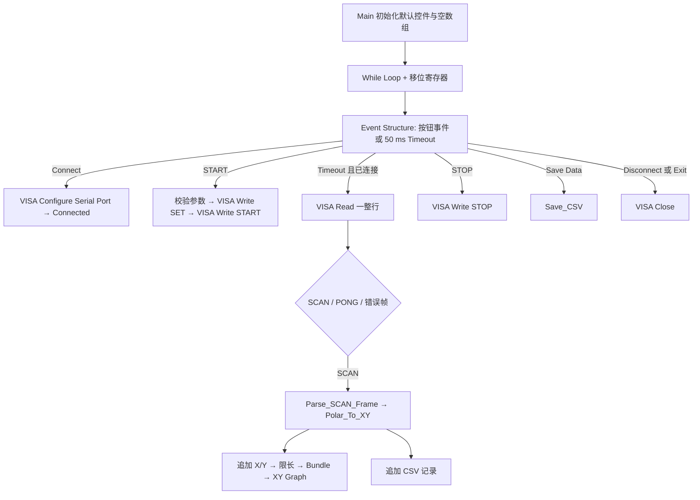

# 04 程序框图逐模块讲解

下面是**搭建目标**，不是已有 VI 的运行截图。各版本 Palette 分类名字可能稍有差别；右键框图后搜索英文节点最稳。先做 `labview/Parse_SCAN_Frame.md` 和 `Polar_To_XY.md`，最后搭 Main。

## 关键节点速查

| 中文 / 英文 | 大概位置 | 输入 → 输出 | 本项目职责 |
|---|---|---|---|
| 配置串口 / VISA Configure Serial Port | Instrument I/O → Serial | COM、baud、数据位、校验、停止位、timeout、error → VISA session、error | Connect 时配置 115200 8N1、LF 终止。配置函数通常也打开 session。 |
| 循环 / While Loop | Programming → Structures | 初始移位寄存器、停止布尔 → 更新后的值 | 保持界面工作，保存上一轮状态。 |
| 事件结构 / Event Structure | Programming → Structures | 按钮事件/timeout → 事件分支 | 响应 Connect、START 等，Timeout 定期接收。 |
| 串口读取 / VISA Read | Instrument I/O → VISA | session、byte count、error → 字符串、error | Timeout 分支读到 LF 为止。byte count 设 256 或 512；超长帧按错误处理。 |
| 串口写入 / VISA Write | Instrument I/O → VISA | session、带 CRLF 字符串、error → 写入字节数、error | 发 SET/START/STOP/PING，串接 error wire 保顺序。 |
| 字符串解析 / Match Pattern、Spreadsheet String To Array | Programming → String | 一行文本 → 类型及数字 | 先按逗号分隔并核对四字段，再转 DBL。详见 06 和 VI 说明。 |
| 极坐标转换 / Sine、Cosine、Multiply | Programming → Numeric/Mathematics | angle、distance → x、y | `angle*pi/180` 后计算坐标。 |
| 数组追加 / Build Array | Programming → Array | 原数组、单点 → 新数组 | X/Y 各追加一项；勾选 Concatenate Inputs。 |
| 数组截尾 / Array Size、Array Subset | Programming → Array | 原数组、最大点数 → 尾部数组 | 只保留最近 500 点。 |
| 打包 / Bundle | Programming → Cluster, Class & Variant | X Array、Y Array → XY cluster | 一条 XY Graph 曲线的数据型别。 |
| CSV 写入 / Write to Text File | Programming → File I/O | 路径、带标题和换行的 UTF-8 文本 → error | Save Data 时写完整记录。 |
| 关闭串口 / VISA Close | Instrument I/O → VISA | session、error → error | Disconnect、严重串口错误和退出时执行。 |

## Main 的真实执行顺序

1. 循环外初始化：状态 `DISCONNECTED`、VISA 是否有效=false、X/Y 空 DBL 数组、记录空数组；前面板参数设置默认值。状态可用 Enum：INIT、DISCONNECTED、CONNECTED、SCANNING、STOPPED、ERROR、EXIT；显示字符串映射为状态栏文字。
2. While Loop 增加上述移位寄存器。Event Structure Timeout 设 50 ms。**Connect Value Change**：无连接才调用 VISA Configure Serial Port，termination char enable=true、LF=10、timeout=200；成功存 session 并设 CONNECTED，失败显示 Serial Error 且不保存坏 session。
3. **START Value Change**：仅在 CONNECTED/STOPPED；先校验前面板数值（见协议），错误仅提示；合法则用 Format Into String 生成 `$SET,%d,%d,%d,%d\r\n`，VISA Write 后再写 `$START\r\n`，两次 error wire 串联。更新 TX Frame 和 SCANNING。两个 Write 任一步失败都转 ERROR 并 Close。
4. **Timeout**：若 session 有效，就执行一次 VISA Read（byte count=256 或 512）。termination 使读在 LF 停下。没有新行的超时是正常空闲：识别 VISA timeout 错误码 `-1073807339`，Clear Errors，仅此情形继续；其他 VISA 错误进入 ERROR、Close。读到完整行时显示 RX Frame，按帧类型分支。`$PONG` 可只标记通信正常；`$SCAN` 调 Parse VI。解析失败显示 Parse Error，但保持连接、继续下一次读取。若只想扫描时接收点，可以在 STOPPED 丢弃合法 SCAN。
5. 解析成功后更新三个数值，调用 Polar VI。X/Y 各 Build Array 追加；若长度超过 Max Graph Points，用 Array Subset 从 `length-max` 开始取 `max` 项。另把 timestamp 和五个数字加到记录数组，供 Save Data 写盘。图只保留最近 500 点，记录数组与图是两份数据。
6. **STOP Value Change**：有效 session 下写 `$STOP\r\n`，状态 STOPPED。**Clear Graph**：X/Y 数组清空并更新 Graph；记录数组不清空。**Save Data**：文件对话框选 CSV，调用 Save_CSV；取消对话框不算错误。**Disconnect**：若 session 有效先 VISA Close，再清有效标志，状态 DISCONNECTED。
7. 关闭窗口或 Exit 按钮进入 EXIT：循环停止后，循环外**再次按有效标志判断并调用 VISA Close**；这个共同出口确保正常退出也关串口。关闭时不要让“已有错误簇”跳过 Close，必要时用独立 error in。

Event Structure 包在 While Loop 内，不在每个分支重新创建循环。VISA 引用从移位寄存器穿过每个事件分支到右边。每个分支都必须给所有移位寄存器赋值；不修改时直接把左值接到右端。**XY Graph 终端放在 Event Structure 外、While Loop 内**，由每轮事件输出的 X/Y 数组 Bundle 后接入；这样 Clear Graph 与接收分支都能通过同一终端更新图，且不用图表局部变量。RX/TX/Status 文字可各用一个字符串移位寄存器，在对应事件更新，Event Structure 外统一接显示器。不要把 VISA Configure 放在 While Loop 之前，否则启动即打开串口，Connect 按钮也失去意义。
